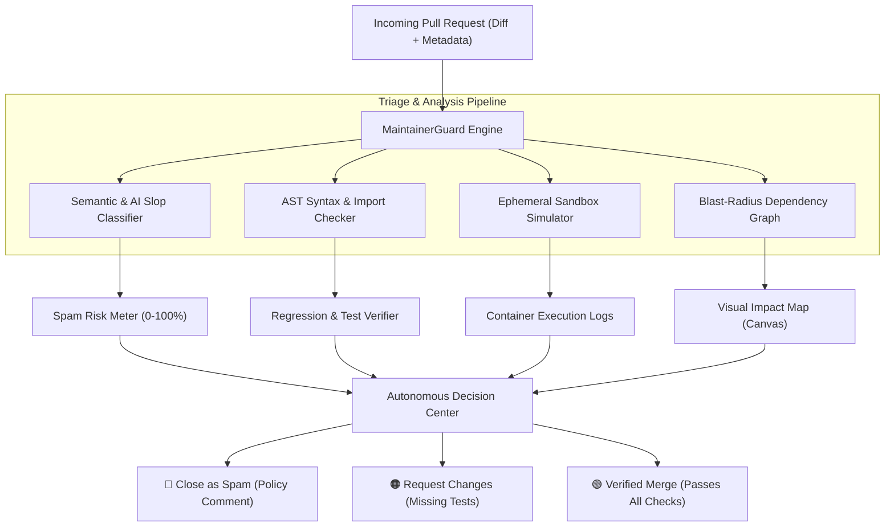

# MaintainerGuard 🛡️
> **Autonomous Open-Source PR & Issue Triage Agent**  
> *Built for Hacktoberfest 2026 — Theme: "AI Belongs to Everyone"*

[](https://hacktoberfest.com)
[](https://fastapi.tiangolo.com)
[](https://ollama.com)
[](LICENSE)

---

## 💡 The Problem: The Hacktoberfest Maintainer Crisis

In 2026, **Major League Hacking (MLH) and DEV** eliminated the 12-year-old Hacktoberfest pull request reward model. 

**Why?** Because modern generative AI tools made it effortless for bad actors and confused contributors to spam open-source repositories with hundreds of low-effort, broken, or hallucinated pull requests (e.g. adding single punctuation marks to READMEs, inserting names into `Contributors.md`, or using AI that hallucinates non-existent libraries). Maintainers faced unprecedented burnout.

---

## 🚀 The Solution: MaintainerGuard

**MaintainerGuard** is a 100% local, privacy-first autonomous triage agent that safeguards open-source maintainers. It intercepts incoming Pull Requests and executes deep multi-layer analysis within milliseconds:

1. **AI Hallucination & Slop Detection:** Detects fabricated imports, imaginary library calls, and non-existent APIs that LLMs hallucinate.
2. **Low-Effort & Churn Heuristics:** Flags trivial typo fixes, whitespace padding, and contributor list spam with an exact **Spam / Risk Index (0–100%)**.
3. **Ephemeral Sandbox Dry-Run Simulator:** Executes AST syntax parsing, dependency resolution, and automated test regression checks in an isolated container.
4. **Architectural Blast-Radius Graph:** Generates an interactive visual dependency map showing which files, API endpoints, and downstream modules are impacted by the PR.
5. **Autonomous GitHub Action & Review:** Auto-generates constructive, policy-compliant GitHub Markdown review comments, applies appropriate labels (`hacktoberfest-spam`, `verified-fix`, `needs-tests`), and offers one-click **Close as Spam** or **Merge PR** actions.

---

## 🏛️ System Architecture



---

## ⚡ 60-Second Quickstart

### 1. Clone & Install Dependencies
```bash
git clone https://github.com/your-username/maintainer-guard.git
cd maintainer-guard

pip install -r requirements.txt
```

### 2. Launch the Application
```bash
python run.py
```

### 3. Open Dashboard
Open your browser and navigate to:
```
http://127.0.0.1:8000
```

---

## 🎮 Live Hackathon Demo Scenarios

The web interface features 3 pre-loaded real-world scenarios ready for instant judging demonstrations:

| Scenario | PR Description | MaintainerGuard Verdict |
| :--- | :--- | :--- |
| **🔴 Scenario 1: AI Swag Spam** | Single line addition to `Contributors.md` for swag. | **92% Spam** ➔ Closed with polite Hacktoberfest 2026 explanation. |
| **🟠 Scenario 2: AI Hallucination** | PR imports `jwt_future_auth` and fictitious method `verify_future_token()`. | **96% Critical Risk** ➔ Blocked for invalid dependencies. |
| **🟢 Scenario 3: Verified Bug Fix** | Fixes async socket descriptor leak in connection pool + unit tests. | **4% Low Risk** ➔ Passes sandbox, ready for 1-click Merge. |

---

## 🛠️ Tech Stack

- **Backend Framework:** FastAPI & Uvicorn
- **AI & Evaluation Engine:** Python AST, Open-Weight Model pipeline (Ollama / Gemma 3:1b compatible)
- **Frontend / Visualization:** HTML5 Canvas, Tailwind CSS, Lucide Icons
- **Event Target:** Hacktoberfest Hack Day Jaipur × NIAT-VGU
